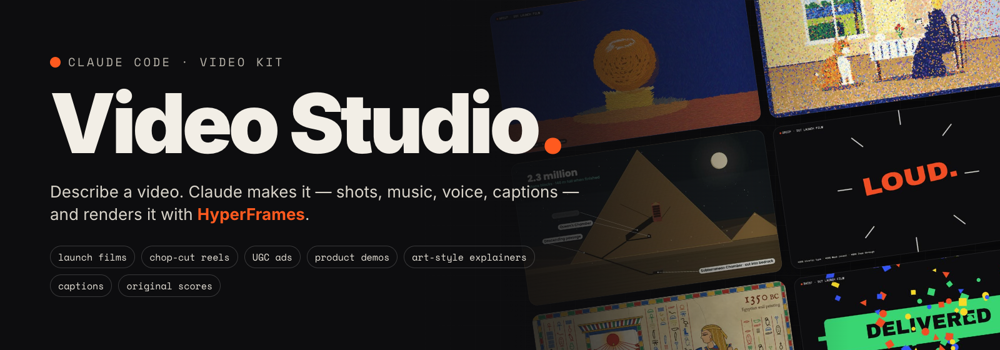
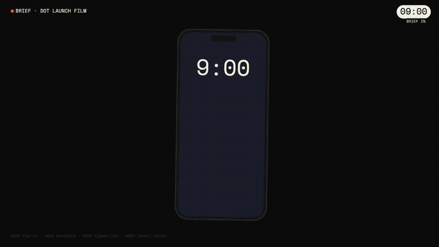
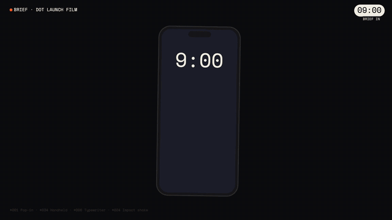
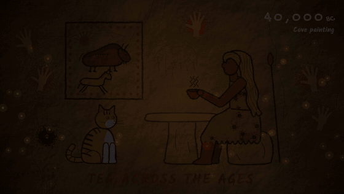
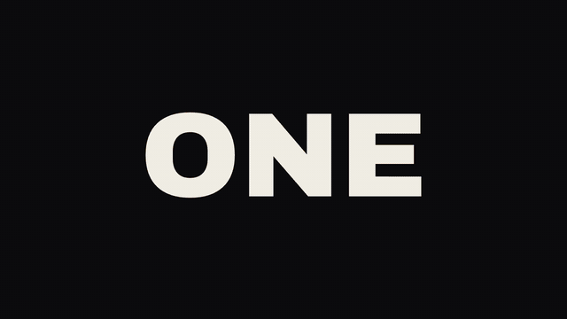
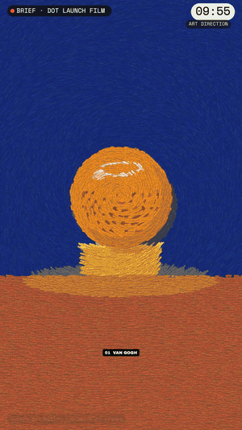
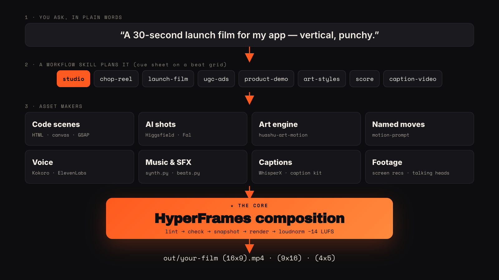

<div align="center">



**Turn Claude Code into a video studio.** Describe the video in plain words. Claude writes the story, makes
the shots, music, voice and captions, and renders a finished MP4, all with
[HyperFrames](https://github.com/heygen-com/hyperframes).

[](LICENSE)
[](https://github.com/heygen-com/hyperframes)
[](https://claude.com/claude-code)
[](#install)
[](https://github.com/akachandan1/video-studio/actions/workflows/ci.yml)

[**Quick start**](#quick-start) · [**Gallery**](#gallery) · [**Workflows**](#what-it-makes) · [**How it works**](#how-it-works) · [**Docs**](#docs) · [**FAQ**](#faq)

<br>



<sub>Every frame above is code: no stock footage, no AI video. Full films in the <a href="examples/">examples</a>.</sub>

</div>

---

## Why

Video tools make you learn the tool. Video Studio makes Claude the editor. You say *"a 30-second launch film
for my app, vertical, punchy"*, and Claude:

- 🎬 **plans it like an editor:** story beats and a cue sheet on a beat grid, so every cut, sound hit and caption lands together
- 🧩 **makes every asset:** code-built motion graphics, painterly animation, AI shots (optional), offline voiceover, original synthesized music, word-synced captions
- ✅ **checks its own work:** HyperFrames lint and layout checks, frame snapshots it actually looks at, delivery at −14 LUFS
- 📐 **delivers every aspect ratio:** 16:9, 9:16 and 4:5 from one edit, re-laid out rather than cropped
- 💸 **costs nothing by default:** paid AI generation is optional, and Claude quotes the cost and waits for your OK first

And it improves over time. Every job that teaches a new trick becomes a skill, a template or a
[playbook rule](docs/PLAYBOOK.md).

## Quick start

> **Use Claude Code**, either the desktop app's Code tab or `claude` in a terminal. Uploading this repo to a claude.ai *chat* won't work, because chat can't render video.

```bash
git clone https://github.com/akachandan1/video-studio.git
```
```bash
cd video-studio && claude
```

Then just say **"hi"**. On first run Claude:

1. checks your Mac (a session-start hook runs [`setup/doctor.sh`](setup/doctor.sh)),
2. offers to install anything missing ([`setup/setup.sh`](setup/setup.sh), about 10 min, idempotent, you approve each step),
3. renders an 8-second [hello-world](templates/hello-world/) film to prove the whole pipeline works,
4. asks what you'd like to make.

New to all of this? Read the one-page [**START-HERE.md**](START-HERE.md).

## Gallery

<table>
<tr>
<td width="50%"><br><b>The Brief</b>: a 45 s chop-cut story reel. A brief, a 60-minute clock, a twist, a nine-style art blitz, delivered. <a href="examples/the-brief/">source</a></td>
<td width="50%"><br><b>What's inside the Great Pyramid?</b> Kurzgesagt-style flat science with a cross-section to scale. <a href="examples/great-pyramid/">source</a></td>
</tr>
<tr>
<td><br><b>Twelve Painters</b>: one scene repainted from Van Gogh to Kusama, one hit per change. <a href="examples/twelve-painters/">source</a></td>
<td><br><b>Eight Eras</b>: from cave painting to Persian miniature. <a href="examples/eight-eras/">source</a></td>
</tr>
<tr>
<td><br><b>Chop-reel template</b>: punch-ins, flash frames, shakes and a whip pan on a 150 BPM grid. Renders 16:9 and 9:16. <a href="templates/chop-reel/">template</a></td>
<td align="center"><br><b>Same edit, 9:16.</b> Layouts are relative to the stage, so one edit serves every platform.</td>
</tr>
</table>

Full-resolution MP4s are on the [Releases](https://github.com/akachandan1/video-studio/releases) page.

## What it makes

| Say something like… | Workflow skill | Paid? |
|---|---|---|
| "a punchy showreel / hype edit with a story" | [`chop-reel`](.claude/skills/chop-reel/SKILL.md) | free |
| "an Apple-style launch film for my product" | [`launch-film`](.claude/skills/launch-film/SKILL.md): signature transitions, minimal supers, piano score, fold-cut builder | free · AI shots optional |
| "UGC ads for Meta and TikTok, 3 hooks, 2 ratios" | [`ugc-ads`](.claude/skills/ugc-ads/SKILL.md) + [`ugc-actor`](.claude/skills/ugc-actor/SKILL.md): ad research first, then AI presenter and variants anchored to spoken words | AI presenter |
| "turn this screen recording into a product demo" | [`product-demo`](.claude/skills/product-demo/SKILL.md): cursor tracking, auto camera, click ripples, chapters, callouts, VO from a script | free |
| "a Kurzgesagt-style explainer" / "paint it like Monet" | [`art-styles`](.claude/skills/art-styles/SKILL.md) | free |
| "caption this video and add a hook" | [`caption-video`](.claude/skills/caption-video/SKILL.md): 7 styles previewed on *your* footage, voice cleanup, grade | free |
| "write original music that hits on every cut" | [`score`](.claude/skills/score/SKILL.md): synth library, cue sheets, beat detection for supplied tracks | free |
| "explainer from this article" · "promo from this URL" · "music video for this track" · "recut this interview" | HyperFrames workflow skills: `faceless-explainer`, `product-launch-video`, `music-to-video`, `talking-head-recut`, `slideshow` | free |
| "use motion #043 for the transition" | [motion-prompt](https://github.com/showheyohtaki/motion-prompt) moves ported into the edit by their exact specs | free |

You don't need to know any of these names. The [`studio`](.claude/skills/studio/SKILL.md) skill is the front door and routes your request.

## How it works



**HyperFrames is the core.** Every video is a HyperFrames composition: HTML, `data-*` timing and one paused GSAP
timeline, rendered deterministically to MP4. Everything else is an *asset maker* that feeds it:

| Asset maker | What it produces |
|---|---|
| Code scenes (HTML · canvas · GSAP) | Motion graphics, kinetic type, UI, data, transitions |
| [huashu-art-motion](https://github.com/alchaincyf/huashu-art-motion) | Painterly and Kurzgesagt-style animation |
| [motion-prompt](https://github.com/showheyohtaki/motion-prompt) | 120 named moves with exact curves |
| Higgsfield · Fal *(optional, your account)* | AI images, video, talking presenters, music videos |
| Kokoro · DeepFilterNet · WhisperX | Offline voiceover, voice cleanup, word-level transcripts |
| [`synth.py`](.claude/skills/score/scripts/synth.py) · [`beats.py`](.claude/skills/score/scripts/beats.py) | Original music & SFX in numpy; beat grids for supplied tracks |

Read the full [catalog](docs/CATALOG.md) for every tool, its cost and its source.

## Install

**Requirements:** macOS (Apple Silicon or Intel), [Claude Code](https://claude.com/claude-code). Everything else is installed by setup.

```bash
setup/setup.sh            # everything, idempotent
```
```bash
setup/setup.sh --only voice   # or one step: brew | hyperframes | skills | plugins | python | voice | denoise | transcribe | browsers
```
```bash
setup/doctor.sh           # ✓/✗ for every tool, with the fix for each ✗
```

Third-party tools are installed from their **official sources**, never copied into this repo. HyperFrames is
pinned in [`setup/versions.env`](setup/versions.env).

**Use the skills in every folder.** The skills load automatically inside this repo. To have them everywhere, install the repo as a plugin:
```bash
claude plugin marketplace add akachandan1/video-studio
```
```bash
claude plugin install video-studio@video-studio
```

## Repo layout

```
CLAUDE.md               what Claude reads first: HyperFrames core, first-run steps, rules
START-HERE.md           one-page guide for people new to all this
.claude/skills/         studio workflows (auto-loaded): studio · chop-reel · launch-film · ugc-ads · ugc-actor
                        product-demo · art-styles · score · caption-video
.claude/settings.json   session-start hook → setup/doctor.sh
templates/              hello-world (proof render) · chop-reel (16:9 + 9:16 engine with score)
examples/               complete films with source: the-brief · great-pyramid · twelve-painters · eight-eras
setup/                  setup.sh · doctor.sh · versions.env
docs/                   PLAYBOOK · CATALOG · SECRETS · media/ (README graphics + their source)
videos/  out/           your projects and renders (gitignored, stay on your machine)
```

## Docs

- [**PLAYBOOK.md**](docs/PLAYBOOK.md): 21 house rules learned on real jobs (cost, real footage, ads, craft)
- [**CATALOG.md**](docs/CATALOG.md): every tool, what it's for, what it costs, where it comes from
- [**SECRETS.md**](docs/SECRETS.md): connecting your own Higgsfield / Fal / Apify accounts
- [**examples/**](examples/): rebuild each showcase film step by step

## FAQ

<details><summary><b>Do I need to pay for anything?</b></summary>

No. Code-made shots, music, voiceover, captions and rendering are all free and local. AI-generated
shots (Higgsfield, Fal) need your own account. Claude always states the model, count and total cost and
waits for your yes.
</details>

<details><summary><b>Does it work on Windows or Linux?</b></summary>

The workflows do, but `setup.sh` is macOS-only for now. The [catalog](docs/CATALOG.md) lists every tool, so you
can install them by hand. A PR for Linux setup is very welcome.
</details>

<details><summary><b>Why HyperFrames and not Remotion / After Effects?</b></summary>

HyperFrames compositions are plain HTML + GSAP, which Claude writes fluently. It renders deterministically,
and it ships lint, layout checks, snapshots, TTS, transcription and background removal in one CLI, so Claude can
verify its own work. Remotion is listed in the catalog as an alternative.
</details>

<details><summary><b>Can it edit my real footage?</b></summary>

Yes: captions, grading, audio cleanup, recuts with B-roll graphics and product demos from screen
recordings. By rule it never regenerates a real person's voice or invents frames
([PLAYBOOK #5](docs/PLAYBOOK.md)).
</details>

<details><summary><b>Where do my projects go? Is anything uploaded?</b></summary>

Projects go in `videos/` and renders in `out/`. Both are gitignored and stay on your machine. Nothing is
uploaded unless you use a paid AI service, and even then only what you ask for.
</details>

## Contributing

Made something? Open a [Showcase issue](https://github.com/akachandan1/video-studio/issues/new?template=showcase.yml).
Have a technique that worked on a real video? See [CONTRIBUTING.md](CONTRIBUTING.md). New workflows,
templates and playbook rules are the most valuable contributions.

## Acknowledgments

Built on [HyperFrames](https://github.com/heygen-com/hyperframes),
[huashu-art-motion](https://github.com/alchaincyf/huashu-art-motion),
[motion-prompt](https://github.com/showheyohtaki/motion-prompt), Kokoro, WhisperX, DeepFilterNet, FFmpeg and
more. See [ACKNOWLEDGMENTS.md](ACKNOWLEDGMENTS.md). Video Studio is an independent project, not affiliated
with Anthropic or HeyGen.

## License

[MIT](LICENSE) © 2026 Chandan

<div align="center"><sub>If Video Studio made you a video, a ⭐ helps others find it.</sub></div>
