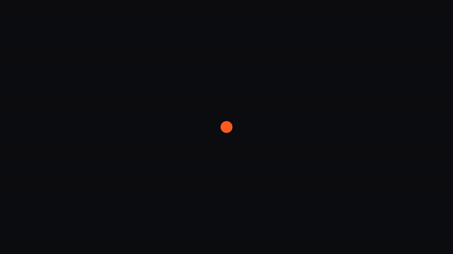

# Examples

Complete films made with the studio's own skills, with full source. Everything here is code: no stock
footage, no AI-generated shots, no samples. Full-resolution MP4s are attached to the
[latest release](../../../releases/latest).

| | Film | Made with | Source |
|---|---|---|---|
|  | **The Brief**, 45 s chop-cut story reel (16:9 + 9:16) | `chop-reel` · `art-styles` · `score` · `caption-video` · motion-prompt · Kokoro | [the-brief/](the-brief/) |
|  | **What's inside the Great Pyramid?**, 16 s Kurzgesagt-style flat science, cross-section to scale | `art-styles` (huashu custom scene) · `score` | [great-pyramid/](great-pyramid/) |
|  | **Twelve Painters**, 25 s, one scene painted from Van Gogh to Kusama | `art-styles` · `score` | [twelve-painters/](twelve-painters/) |
|  | **Eight Eras**, 21 s, from cave painting to Persian miniature | `art-styles` · `score` | [eight-eras/](eight-eras/) |
|  | **Chop-reel template**, 12 s starter that renders 16:9 and 9:16 | `chop-reel` · `score` | [templates/chop-reel/](../templates/chop-reel/) |
|  | **Hello world**, the 8 s proof render every new install makes | HyperFrames · `score` | [templates/hello-world/](../templates/hello-world/) |

## Rebuilding an example
Each folder holds only *our* files: scenes, edit, score and the HyperFrames assembly. The engines are installed
by `setup/setup.sh`: HyperFrames, plus [huashu-art-motion](https://github.com/alchaincyf/huashu-art-motion)
(MIT) for the art examples. Each README lists the exact commands. Or just ask Claude: *"rebuild the
great-pyramid example"*.
