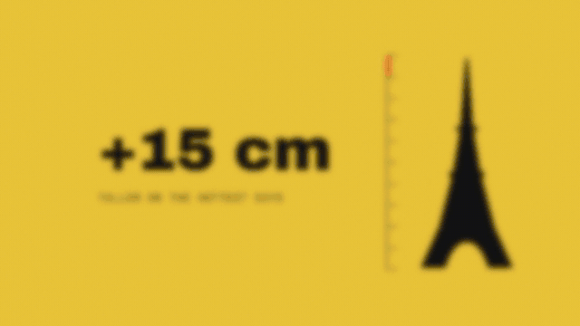
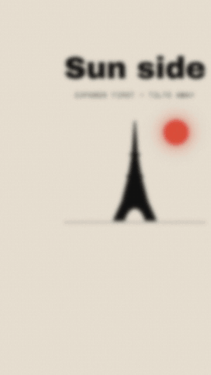

# Why the Eiffel Tower grows every summer: a 60-second explainer

 

Made with the [`explainer`](../../.claude/skills/explainer/SKILL.md) workflow in **code mode**: no AI clips and
no generator, so it costs nothing. Six 10-second blocks, the editorial `collage` look, Kokoro `am_michael` narration,
an original 96 BPM score (one block = 16 beats, a hit on every block change), counting callouts, marker circles and
captions. Rendered in HyperFrames at 16:9 and 9:16, then loudness-normalised to about −14 LUFS.

**The script** (each line voiced and fitted to its 10-second block; every number cross-checked in two sources):

| Block | Line | Callout |
|---|---|---|
| 1 | Every summer, the Eiffel Tower quietly grows. On the hottest days, it can stand up to fifteen centimetres taller. | +15 cm |
| 2 | Finished in eighteen eighty-nine, it is eighteen thousand iron parts, held together by two and a half million rivets. | 2.5M |
| 3 | Iron expands as it warms up. Every single metre of it grows about twelve thousandths of a millimetre for each degree of heat. | 0.012 mm |
| 4 | On its own, that sounds tiny. But spread it across three hundred metres of iron lattice, and one long Paris heatwave adds up very quickly. | 300 m |
| 5 | The side facing the sun warms and expands first, so on bright afternoons the whole tower leans slightly, quietly, away from the sun. | Sun side |
| 6 | So the tower breathes with the seasons. And every seven years, teams of painters coat it by hand, to protect two and a half million rivets from rust. | 7 yrs |

**Fact-check notes.** The summer growth is reported as roughly 12–15 cm, so the script says "up to fifteen". Total
paint figures disagree between sources (50 vs 60 tonnes), so the script leaves them out. Sources are in
[`pack.json`](pack.json).

## Rebuild
```bash
cp -R examples/explainer-eiffel videos/explainer-eiffel
python3 .claude/skills/explainer/tools/voice.py videos/explainer-eiffel           # all takes should say "ok"
.venv/bin/python .claude/skills/explainer/tools/build.py videos/explainer-eiffel   # add --aspect 9:16 for vertical
cd videos/explainer-eiffel && npx --yes hyperframes@0.8.172 render -o raw.mp4
ffmpeg -y -i raw.mp4 -af loudnorm=I=-14:TP=-1:LRA=11 -c:v copy -c:a aac -b:a 192k "../../out/Eiffel explainer (16x9).mp4"
```
To make the AI-clip version, drop `block01.mp4 … block06.mp4` into `videos/explainer-eiffel/clips/` (prompts from
the workflow's style guide) and rebuild. Blocks with a clip use it; the rest stay code scenes.
